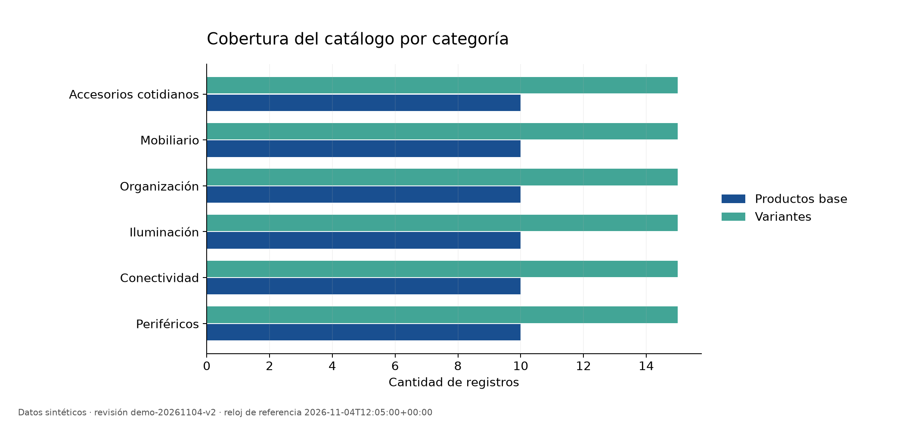
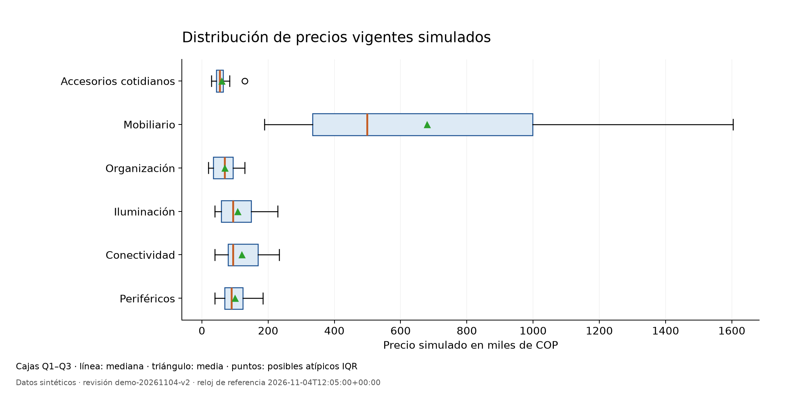
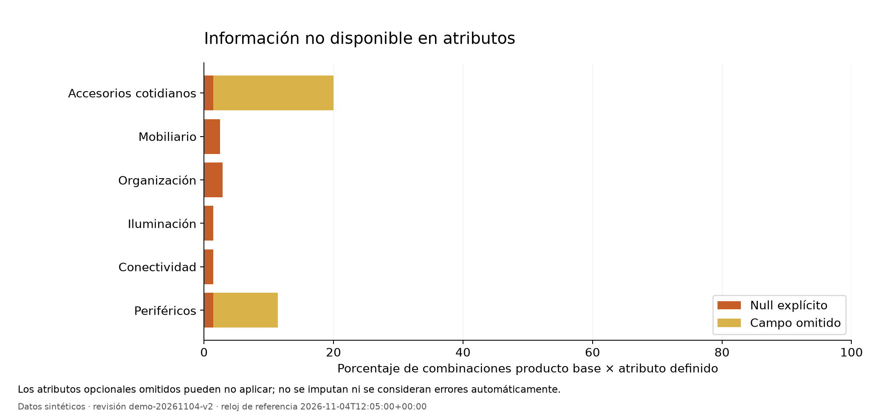
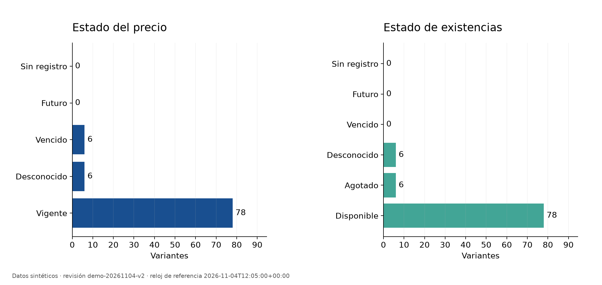
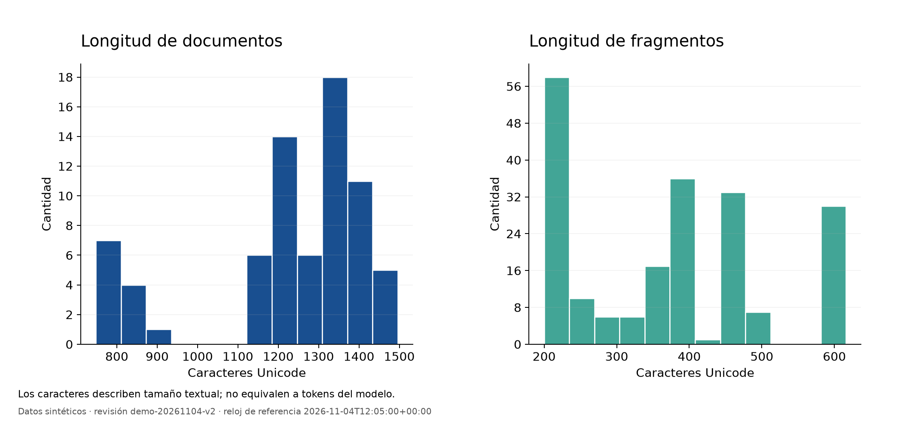

# Exploración del conjunto de datos de Nexo Demo

Este análisis describe la revisión `demo-20261104-v2` del catálogo de demostración. Los productos, atributos, precios y existencias son sintéticos; estas cifras no describen una tienda ni una muestra de clientes reales. No se invocaron modelos ni se abrieron casos de evaluación reservados.

El reloj comercial declarado es **2026-11-04T12:05:00+00:00**. La vigencia de precios y existencias se calcula en ese instante de simulación, no en la fecha de lectura del informe. La procedencia de cada entrada está identificada por SHA256 en `summary.json`.

## Resultados descriptivos

Se analizaron 6 categorías, 60 productos base, 90 variantes, 90 registros comerciales, 72 fuentes y 204 fragmentos.

| Categoría | Productos | Variantes | Precios vigentes | Media COP | Mediana COP |
| --- | ---: | ---: | ---: | ---: | ---: |
| Periféricos | 10 | 15 | 13 | 99,384.62 | 89,000.00 |
| Conectividad | 10 | 15 | 13 | 120,153.85 | 94,000.00 |
| Iluminación | 10 | 15 | 13 | 107,846.15 | 94,000.00 |
| Organización | 10 | 15 | 13 | 68,615.38 | 69,000.00 |
| Mobiliario | 10 | 15 | 13 | 679,384.62 | 499,000.00 |
| Accesorios cotidianos | 10 | 15 | 13 | 59,384.62 | 54,000.00 |

Hay 78 precios vigentes simulados utilizables. Su media global es 189,128.21 COP, mediana 89,000.00, mínimo 19,000.00, máximo 1,604,000.00 y desviación estándar muestral 294,312.95. Los 12 registros restantes se excluyen de estos cálculos por su estado; nunca se convierten en precio cero. La distribución global reúne categorías con niveles de precio distintos, por lo que la tabla y el gráfico por categoría son necesarios para interpretarla. En estas tablas la coma separa miles y el punto indica decimales; los CSV conservan valores numéricos sin separador de miles.

Los estados de precio son `{'fresh': 78, 'unknown': 6, 'stale': 6, 'not_yet_valid': 0, 'not_found': 0}`. Los estados de existencias son `{'in_stock': 78, 'out_of_stock': 6, 'unknown': 6, 'stale': 0, 'not_yet_valid': 0, 'not_found': 0}`. Un estado disponible con cantidad desconocida no se transforma en cero unidades; esa cantidad permanece vacía en `commercial.csv`.

Al considerar todas las combinaciones entre producto base y atributo definido en su categoría, se observan 402 valores conocidos, 8 valores `null` explícitos y 20 campos omitidos. Los atributos opcionales omitidos pueden no aplicar al tipo concreto de producto. No se presupone que sean errores ni se inventa información para completarlos. Los atributos de las variantes no se duplican como observaciones técnicas independientes.

La longitud media de los documentos es 1,227.08 caracteres y la de los fragmentos 374.19. Sus medianas son 1,277.50 y 380.00, respectivamente. Estas longitudes no son conteos de tokens.

## Preparación y tratamiento de datos

1. Se validan los contratos, tipos, unidades, relaciones entre producto y variante, ámbito de las fuentes, hashes y pertenencia literal de los fragmentos. Un defecto de integridad detiene la exportación.
2. Se conserva la distinción entre valor desconocido, campo opcional ausente, precio vencido y artículo agotado. La estadística de precios usa únicamente observaciones vigentes y conocidas al reloj declarado.
3. Los atributos numéricos se resumen por categoría, clave y unidad a nivel de producto base. No se mezclan centímetros, gramos, vatios ni otras magnitudes en una misma media.
4. Se emplean cuartiles con interpolación lineal sobre la posición `(n-1) p` y desviación estándar muestral para `n >= 2`. Para muestras vacías o insuficientes se conserva `null`, sin inventar ceros.
5. Se marcan posibles atípicos fuera de `[Q1 - 1.5 IQR, Q3 + 1.5 IQR]` únicamente cuando `n >= 4`, por categoría y variable. Hay 11 observaciones marcadas en `outliers.csv`. Se conservan todas: un valor extremo puede ser válido y requiere revisión del contexto.
6. No se codifican categorías como números ordinales ni se escalan precios para este resumen descriptivo. La representación semántica y normalización de embeddings pertenecen a la ingesta RAG, no a una transformación de estas variables comerciales.
7. El equipo no entrena un predictor supervisado con estas filas. Por tanto, un reparto aleatorio entrenamiento/prueba del catálogo no sería una evaluación de ese tipo de modelo. El proyecto mantiene casos de ajuste y finales separados para evaluar recuperación y comportamiento del asistente; este análisis no evalúa sus respuestas.

## Gráficos












## Reproducción y archivos

Desde la raíz del proyecto, después de instalar el extra `analysis`:

```powershell
.\.venv\Scripts\python.exe -m ragml.analysis --output-dir docs/analysis/nueva-ejecucion
```

El directorio de salida debe ser nuevo. Puede especificarse `--evaluated-at` con una fecha ISO 8601 que incluya zona horaria. `--no-charts` exporta solo datos y tablas cuando Matplotlib no está disponible.

`summary.json` conserva datos, estadísticas, versiones, reloj y huellas de entrada. `categories.csv`, `attributes.csv`, `commercial.csv`, `documents.csv` y `outliers.csv` permiten revisar cada grupo de resultados. Las figuras se guardan en PNG y SVG. Los CSV usan UTF-8 con BOM y conservan vacíos para valores no disponibles; las etiquetas y decimales no deben interpretarse como datos comerciales reales.

La distribución equilibrada por categoría es una decisión del generador, no un hallazgo sobre ventas o demanda. La muestra pequeña y sintética impide generalizar estos patrones a mercados reales o afirmar utilidad del asistente para usuarios.
