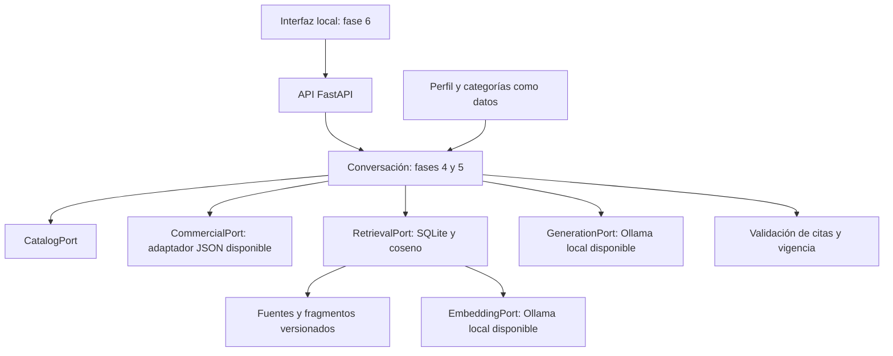

# Arquitectura de la fase 2

Fecha de cierre: 4 de noviembre de 2026. Estado: **DONE para la base técnica local**.
No equivale a completar el RAG, la interfaz o la evaluación con personas.

## Alcance y decisiones

El usuario autorizó escoger tecnologías y modelos adecuados para un prototipo de clase,
priorizando ejecución local y servicios gratuitos. Se conserva Nexo Demo y la posibilidad
posterior de sustituir su perfil y sus datos mediante configuración y adaptadores.

| Componente | Decisión de fase 2 | Estado |
| --- | --- | --- |
| Lenguaje y entorno | Python 3.13.7, uv y paquete instalable | Instalado, fijado y comprobado |
| Servidor | FastAPI y Uvicorn en loopback | API de base ejecutable |
| Contratos | Pydantic; configuración con pydantic-settings | Modelos y validadores ejecutables |
| Interfaz | HTML, CSS y JavaScript nativo, servidos por FastAPI desde el mismo origen | Seleccionada; construcción en fase 6 |
| Catálogo y comercio | JSON canónico validado; precios y stock separados de documentos | Contratos y adaptador comercial disponibles |
| Persistencia e índice | SQLite local; vectores normalizados y similitud coseno exacta para este corpus pequeño | Tecnología y capacidades comprobadas; ingesta e índice en fases 3 y 4 |
| Generación | Qwen3 4B Instruct 2507, Q4_K_M, mediante Ollama | Descargado, fijado por digest y probado localmente |
| Representaciones | Qwen3 Embedding 0.6B, Q8_0, 1024 dimensiones | Descargado, fijado por digest y probado localmente |

No se necesitan una base vectorial administrada, contenedores, LangChain, cuentas de nube ni
un proceso de compilación frontend para este alcance. La recuperación mejorada se justificará
con los casos de ajuste, conservando la configuración básica para comparar.

## Organización

Los puertos de catálogo, fuentes, recuperación, generación, embeddings y sesiones están en
`src/ragml/ports.py`; el comercial está en `commercial.py`. Las implementaciones de recuperación,
repositorio documental y conversación pertenecen a las fases siguientes.

## Recorrido acordado para el RAG

1. Validar mensaje y sesión; resolver la tienda desde la configuración del servidor.
2. Resolver referencias a productos o pedir aclaración si existen varias variantes posibles.
3. Consultar catálogo y recuperar solo evidencia de la tienda, revisión y alcance pertinentes.
4. Consultar precios o existencias de la variante exacta cuando la intención lo requiera.
5. Separar instrucciones del sistema de la evidencia documental no confiable. Los fragmentos
   no autorizan herramientas, cambios de reglas ni acceso a secretos.
6. Construir un contexto dentro del presupuesto y generar con el modelo local fijado.
7. Validar asociaciones, versiones, ubicaciones, extractos y vigencia antes de devolver resultados.
8. Guardar solo el contexto y las mediciones necesarios. La fidelidad semántica se evaluará aparte.

Este recorrido está diseñado y sus límites tienen contratos; el orquestador no está implementado.
La API devuelve explícitamente `rag_not_ready`, incluso si ya hay archivos de fase 3 disponibles.

## Vigencia e independencia de fuentes

`source_updated_at` indica actualización en origen; `checked_at` indica lectura. La lectura no
renueva el dato. Una observación comercial es vigente si
`source_updated_at <= evaluated_at < expires_at`. Precio y stock se evalúan por separado.
Desconocido, agotado, ausente, vencido y fuente caída conservan significados distintos.

La demostración utiliza ventanas sintéticas explícitas y un reloj de referencia registrado por
fase 3. No se cambian las fechas al abrir el programa. Una nueva revisión de demostración se
publica expresamente con sus metadatos; el servicio no renueva ventanas en silencio. La política
inicial de una fuente real será de 15 minutos configurables, sujeta a su responsable y autorización.

La actualización comercial tiene revisión propia y no exige reindexar manuales. El índice guardará
identidad de tienda, revisión, modelo y digest. Cambiar el modelo de embeddings exige reconstruir
sus vectores; no se mezclarán dimensiones o versiones. Los documentos retirados dejarán de
recuperarse como activos. Las políticas generales mantienen alcance de tienda.

## Cambio de tienda y sesiones

La instancia tiene una tienda activa. Cambiar perfil o tienda reinicia las sesiones y cambia el
espacio del índice. Los nombres, categorías, atributos, moneda y políticas proceden de datos.
El origen real puede requerir un adaptador que traduzca al modelo canónico sin cambiar el núcleo.

Las pruebas actuales cubren dos tiendas sintéticas con IDs locales repetidos, distintas categorías,
monedas y valores. Eso comprueba la separación de contratos y comercio; la migración del recorrido
completo y de las políticas se comprobará cuando exista el asistente integrado.

El repositorio de sesiones recibirá un identificador de propietario además de sesión y tienda.
El servidor generará identificadores opacos; el cliente no podrá adoptar otra tienda mediante el
mensaje. TTL de diseño: 1.800 segundos; mensaje: hasta 4.000 caracteres. Persistencia, aislamiento
entre clientes y manejo de historial se implementarán y probarán en fase 5.

## Evidencia y cierre

- 44 comprobaciones de software pasan, con análisis estático, formato y tipos sin errores.
- El paquete se construyó y se instaló desde wheel en un entorno separado del editable.
- Hubo inferencia real en español y embeddings reales de 1024 dimensiones con texto sintético.
- Se comprobó HTTP real: salud 200, disponibilidad RAG 503 y errores de entrada 422.
- Los datos de fase 3 que aparecieron en paralelo pasan los contratos actuales: 60 productos,
  90 variantes, 72 fuentes y 204 fragmentos. No se modificaron para cerrar esta fase.

Los criterios originales de fase 2 tienen evidencia en [entorno](local-environment.md),
[modelos](local-models.md), [contratos](contracts.md) y [decisiones y presupuesto](decisions.md).
Las medidas son comprobaciones de infraestructura, no resultados del protocolo final.
La fase 1 mantiene sus pendientes empíricos y académicos; el informe de avance corresponde a fase 8.
