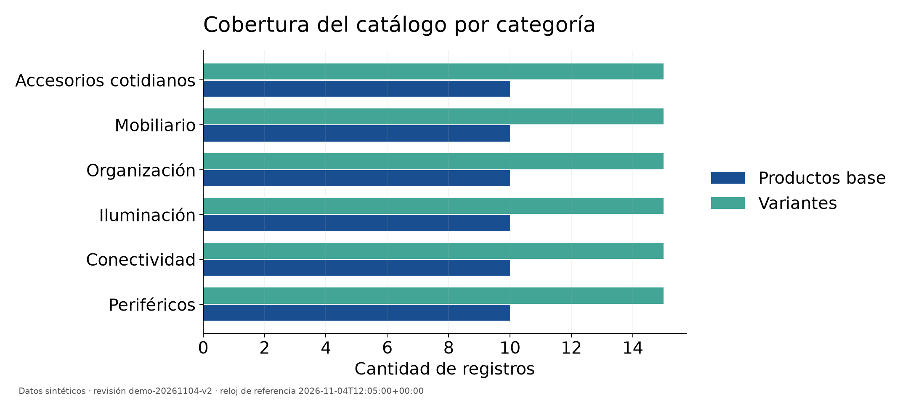
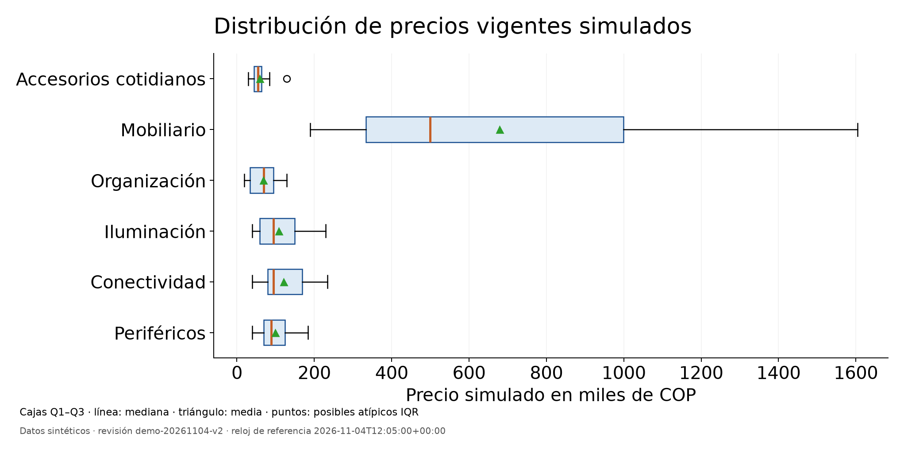
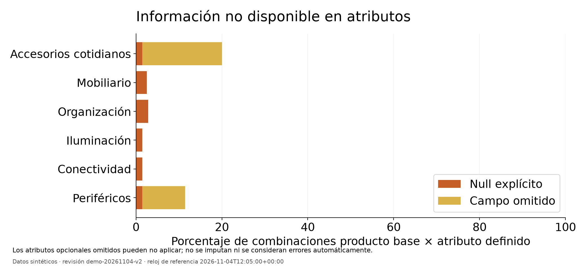
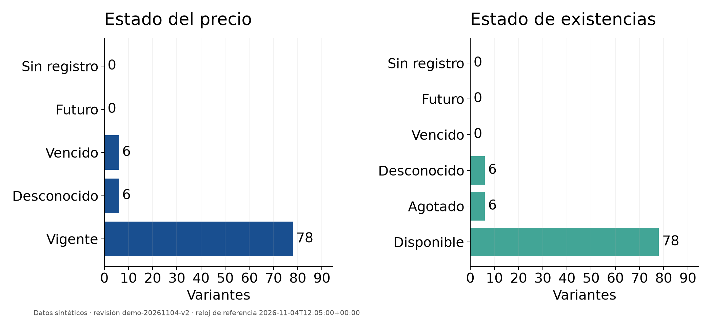
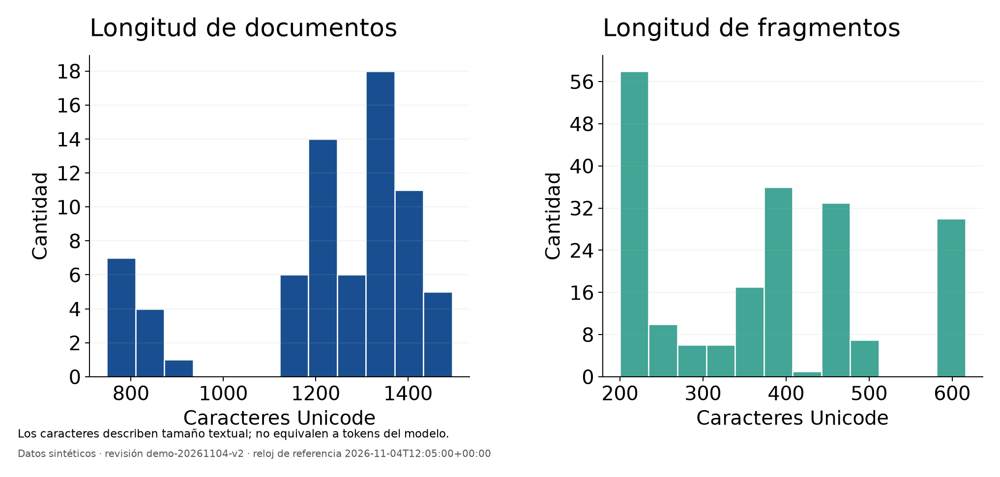
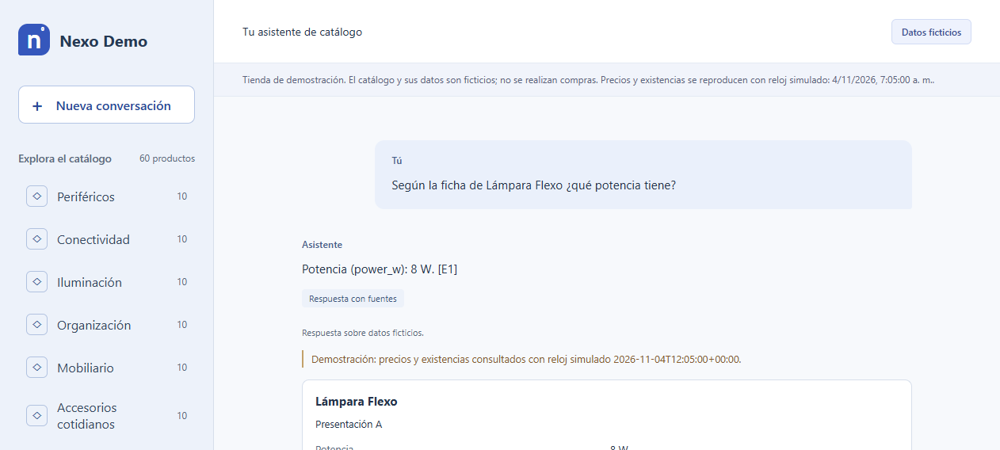

# Asistente conversacional con aprendizaje automático preentrenado y recuperación documental para Nexo Demo

Universidad de Santander

Proyecto de la asignatura Machine Learning

Informe del proyecto para el Previo 3

10 de noviembre de 2026

## Resumen

Este proyecto aborda la consulta de un catálogo comercial mediante una aplicación local en Python. El entorno es Nexo Demo, una tienda ficticia con seis categorías, 60 productos y 90 variantes. El asistente combina modelos de lenguaje preentrenados con recuperación documental para responder preguntas con fuentes identificables. Las consultas de precio, existencias y selección de productos utilizan registros estructurados y reglas explícitas, separados de la información documental.

La solución incluye un catálogo validado, 72 fuentes documentales, 204 fragmentos, un índice local y una interfaz web en español. La aplicación permite consultar características, comparar alternativas y modificar requisitos durante una conversación. El trabajo documenta la preparación de los datos, la exploración estadística y la evaluación del funcionamiento. Las mediciones se interpretan según su alcance: encontrar un fragmento de referencia no equivale a responder correctamente, y una prueba de software no demuestra utilidad con clientes. Los productos y las condiciones comerciales son sintéticos; no se realizaron entrevistas ni se atribuyen resultados a una empresa real.

## 1 Título del proyecto

Asistente conversacional con aprendizaje automático preentrenado y recuperación documental para Nexo Demo.

El título identifica la aplicación y el componente de Machine Learning efectivamente utilizado. El proyecto emplea inferencia con modelos ya entrenados por sus autores y una arquitectura de generación aumentada por recuperación, conocida como RAG. La implementación no incluye entrenamiento de una red neuronal desde cero ni ajuste de los pesos de los modelos.

## 2 Planteamiento del problema

### 2 1 Contexto

Una persona que consulta un catálogo necesita relacionar el nombre del producto con sus características, variantes y condiciones de compra. Las fichas pueden distribuir la información entre varios documentos, mientras que las políticas de garantía o entrega se aplican a un conjunto más amplio de artículos. Para comparar opciones también es necesario reconocer qué atributos son relevantes en cada categoría y cuáles representan requisitos obligatorios.

El proyecto sitúa estas tareas en Nexo Demo, un negocio ficticio de productos para el hogar y el espacio de trabajo. Incluye periféricos, conectividad, iluminación, organización, mobiliario y accesorios cotidianos. El entorno controlado permite construir casos reproducibles de información completa, datos desconocidos, productos agotados y registros comerciales vencidos. Esta contextualización constituye una simulación académica; la frecuencia de los problemas descritos no se ha medido en clientes reales.

### 2 2 Problema identificado

El problema consiste en reunir y comprender información suficiente para consultar o seleccionar un producto sin confundir sus características con las de otro artículo o variante. Una búsqueda por palabras exactas puede resultar limitada cuando la necesidad se expresa en lenguaje cotidiano. A su vez, una respuesta generada sin consultar las fuentes puede ofrecer información que el catálogo no respalda.

La dificultad también afecta las recomendaciones. Un artículo puede ser pertinente por su uso y, al mismo tiempo, exceder el presupuesto, carecer de una característica requerida o no tener existencias confirmadas. La aplicación debe hacer visibles esas condiciones para apoyar la decisión del usuario.

### 2 3 Causas

Las causas consideradas en el diseño son la distribución de información entre fichas y políticas; la diversidad de vocabulario entre una consulta y el catálogo; la existencia de variantes con condiciones distintas; y la presencia de atributos incompletos. Además, los precios y las existencias cambian con el tiempo y necesitan una fuente y una ventana de vigencia propias. Estas causas son hipótesis contextualizadas de trabajo y condiciones introducidas en la simulación, no resultados de un diagnóstico empresarial.

### 2 4 Consecuencias

Estas condiciones pueden aumentar el esfuerzo necesario para comparar productos y dificultar la comprobación de una respuesta. También pueden ocasionar selecciones que incumplan requisitos o confirmaciones comerciales apoyadas en información antigua. En una demostración académica, permiten observar si el sistema reconoce sus límites, solicita aclaraciones y conserva la relación entre una afirmación y su fuente.

El proyecto se concentra en consulta y orientación. No procesa pagos, ejecuta compras, administra devoluciones ni consulta pedidos personales. Tampoco presupone mejoras de ventas, satisfacción o tiempos de atención antes de medirlas.

## 3 Formulación del problema

¿Cómo implementar y evaluar un asistente conversacional en Python que utilice modelos de aprendizaje automático preentrenados y recuperación documental para consultar y comparar productos de Nexo Demo, con fuentes verificables y tratamiento explícito de restricciones, datos desconocidos y vigencia comercial?

## 4 Objetivo general

Desarrollar y evaluar un asistente conversacional local para consultar y comparar productos de Nexo Demo mediante modelos de aprendizaje automático preentrenados, recuperación documental y consulta de registros estructurados, con respuestas trazables a sus fuentes.

## 5 Objetivos específicos

1. Organizar y validar un dataset sintético de seis categorías, 60 productos, 90 variantes y sus fuentes documentales, conservando identificadores, unidades, procedencia y valores desconocidos.
2. Explorar el dataset mediante conteos, estadística descriptiva y gráficos que permitan interpretar su distribución, los valores faltantes y las condiciones comerciales de prueba.
3. Implementar la recuperación de fragmentos mediante embeddings y similitud coseno, y conectar un modelo de lenguaje que seleccione evidencia documental verificable.
4. Integrar una aplicación web en español que permita nuevas consultas, comparación de alternativas y cambios de presupuesto, separando las reglas comerciales de la generación documental.
5. Evaluar la recuperación y el recorrido integrado con casos identificados, registrar resultados y tiempos, e interpretar los errores y límites observados sin atribuirlos a una población no estudiada.

## 6 Justificación

### 6 1 Importancia y beneficios esperados

El proyecto permite estudiar cómo una aplicación reúne información distribuida y la presenta en una conversación. La posibilidad de revisar la fuente de una afirmación facilita su comprobación y permite explicar por qué se propone una alternativa o por qué no puede confirmarse un dato. Para una futura tienda, el beneficio potencial sería apoyar consultas recurrentes; demostrarlo requeriría una evaluación con sus datos autorizados y sus usuarios.

Los beneficiarios previstos son personas que consultan o comparan productos y personal que mantiene la información del catálogo. En esta entrega, el beneficio comprobable se limita a disponer de un prototipo reproducible y de evidencia técnica sobre un escenario de demostración.

### 6 2 Pertinencia de Machine Learning

Las consultas y los documentos se representan mediante embeddings producidos por un modelo preentrenado. Estas representaciones permiten recuperar evidencia según relaciones aprendidas durante el entrenamiento del modelo, además de las coincidencias literales. El modelo de lenguaje participa después en la selección de los extractos que respaldan una respuesta. La pertinencia del enfoque se contrasta con casos de consulta y sus fuentes, en lugar de suponerse por el tamaño del modelo.

El proyecto aplica programación en Python, representación de información, búsqueda, preparación de datos y evaluación dentro del ciclo de vida de una solución de ML. RAG es la arquitectura que conecta esos componentes; la similitud coseno y el filtrado comercial son operaciones deterministas. La actividad permite seleccionar técnicas pertinentes, y esta implementación se concentra en el uso evaluado de aprendizaje preentrenado. No se presentan regresión, KNN, árboles, K-Means o PCA como algoritmos implementados.

### 6 3 Viabilidad y delimitación

La inferencia se ejecuta localmente y las fuentes son sintéticas. Esta decisión evita depender de documentos de una empresa o de datos personales para construir y repetir el experimento. El catálogo mantiene un perfil y contratos de acceso separados del diálogo, lo cual facilita preparar futuras fuentes. La adaptación a una tienda real sigue requiriendo autorización, revisión de datos y nuevas pruebas.

## 7 Estado del arte

### 7 1 Generación aumentada por recuperación

El trabajo *Retrieval-Augmented Generation for Knowledge-Intensive NLP Tasks*, de Lewis et al. (2020), busca mejorar tareas que requieren conocimiento externo. Su metodología combina un modelo generativo de secuencia a secuencia con un recuperador neuronal y un índice denso de Wikipedia; compara variantes que mantienen o cambian la evidencia durante la generación. Sus autores reportan avances en tres tareas de preguntas abiertas y una generación más específica y factual frente a una referencia paramétrica. El aporte para este proyecto es la separación entre conocimiento aprendido y evidencia recuperable. Nexo Demo adapta esa organización a un corpus comercial pequeño, sin reproducir el entrenamiento ni los experimentos originales. [Fuente primaria](https://arxiv.org/abs/2005.11401).

### 7 2 Recuperación densa de pasajes

En *Dense Passage Retrieval for Open-Domain Question Answering*, Karpukhin et al. (2020) estudian la selección de pasajes para responder preguntas. Utilizan un esquema de dos codificadores que aprende representaciones de preguntas y textos. En los conjuntos evaluados reportan mejoras absolutas de 9 a 19 puntos porcentuales frente a una referencia Lucene-BM25 en recuperación de los primeros 20 pasajes. Este resultado respalda investigar representaciones densas, pero no demuestra que cualquier embedding supere a una búsqueda léxica en cualquier catálogo. El proyecto utiliza un codificador preentrenado diferente y calcula la similitud exacta sobre su propio corpus. [Fuente primaria](https://aclanthology.org/2020.emnlp-main.550/).

### 7 3 Organización de las arquitecturas RAG

Gao et al. (2024), en *Retrieval-Augmented Generation for Large Language Models: A Survey*, revisan la evolución del enfoque y organizan sus componentes y retos de evaluación. La metodología es una revisión de literatura, no un ensayo sobre una sola tienda. Como resultado, distinguen los paradigmas Naive RAG, Advanced RAG y Modular RAG, y examinan recuperación, generación y aumento de información. La versión consultada es la quinta, publicada el 27 de marzo de 2024. Su aporte es un vocabulario para delimitar componentes y mejoras; sus conclusiones no constituyen una medición del prototipo. [Fuente primaria](https://arxiv.org/abs/2312.10997v5).

### 7 4 Contexto de los fragmentos y búsqueda híbrida

Anthropic (2024), en *Introducing Contextual Retrieval*, propone mejorar la recuperación añadiendo contexto específico a los fragmentos antes de indexarlos. Combina embeddings contextuales y BM25, y examina el reordenamiento posterior. Sus experimentos reportan una reducción relativa del fallo de recuperación top 20 del 49 %, de 5,7 % a 2,9 %, y del 67 % con reordenamiento. Estas cifras pertenecen a sus condiciones de prueba. El aporte para Nexo Demo es reconocer que la fragmentación puede perder información y que una recuperación híbrida es una alternativa a comparar si el análisis de errores lo justifica. La implementación actual conserva secciones e identificadores; no incorpora BM25 contextual ni un reranker. [Fuente primaria](https://www.anthropic.com/research/contextual-retrieval).

### 7 5 Documentos técnicos con información estructurada

Sobhan y Haque (2025), en *LLM-Assisted Question-Answering on Technical Documents Using Structured Data-Aware Retrieval Augmented Generation*, buscan responder sobre documentos con tablas e imágenes. Combinan búsqueda vectorial con un reranker basado en Gemma-2-9b-it, ajustado mediante RAFT. Reportan fidelidad de 0,94 y relevancia de respuesta de 0,87 con RAGAs, además de resultados con DeepEval. El aporte es mostrar la importancia de preservar la estructura y evaluar por separado la respuesta. Su corpus y configuración difieren del catálogo utilizado aquí; el prototipo no procesa automáticamente tablas o imágenes de cualquier PDF ni reproduce ese ajuste. [Fuente primaria](https://arxiv.org/abs/2506.23136).

### 7 6 Evaluación de sistemas RAG

En *RAGAs: Automated Evaluation of Retrieval Augmented Generation*, Es et al. (2024) presentan un marco para evaluar distintas dimensiones de un pipeline RAG mediante métricas apoyadas en modelos de lenguaje, sin exigir respuestas humanas de referencia para cada cálculo. El resultado es un conjunto de medidas que separa recuperación, uso fiel del contexto y calidad de generación. El aporte para este proyecto es esa separación conceptual. La entrega utiliza sus propios registros y criterios verificables; no afirma haber ejecutado la biblioteca RAGAs ni equipara una cita literal con una respuesta semánticamente correcta. [Fuente primaria](https://aclanthology.org/2024.eacl-demo.16/).

### 7 7 Casos comerciales relacionados

Amazon, en *Meet Alexa for Shopping, your personalized, agentic AI assistant on Amazon*, describe preguntas sobre productos, comparación y orientación basadas en el catálogo y el contexto de compra. Es una presentación corporativa de capacidades, no un experimento controlado ni una especificación completa de algoritmos. Su resultado observable en la fuente es la descripción de funciones disponibles; no ofrece una estimación causal transferible a Nexo Demo. Sirve para contextualizar el tipo de interacción, manteniendo fuera del prototipo las compras y la personalización basada en datos personales. La página se cita sin fecha porque la consulta no expuso una fecha editorial inequívoca. [Fuente primaria](https://www.aboutamazon.com/news/retail/alexa-for-shopping-ai-assistant).

Microsoft (2026), en *Tiendas CUADRA delivers always-on customer service and product discovery with Copilot Studio*, documenta una implementación por fases para atención y descubrimiento de productos. La solución integra Copilot Studio, flujos y sistemas empresariales. La fuente informa automatización de consultas y evolución hacia recomendaciones, pero no permite atribuir una arquitectura RAG idéntica a la del proyecto. Su aporte es la separación entre consulta, descubrimiento y operaciones comerciales. Sus resultados son un relato del proveedor y no se usan como evidencia de eficacia de esta demostración. [Fuente primaria](https://learn.microsoft.com/en-us/power-platform/guidance/case-studies/tiendas-cuadra-customer-service).

### 7 8 Comparación y aporte del proyecto

| Grupo de antecedentes | Coincidencia con el proyecto | Diferencia relevante |
| --- | --- | --- |
| Lewis y Karpukhin | Recuperar evidencia mediante representaciones aprendidas. | Nexo Demo usa modelos ya entrenados y un corpus comercial sintético pequeño. |
| Gao y Anthropic | Separar componentes y examinar el efecto de la recuperación. | No se implementan todas las mejoras descritas por estas fuentes. |
| Sobhan y Haque | Preservar información y evaluar respuestas documentales. | El corpus es Markdown estructurado; no se reproduce el procesamiento multimodal. |
| Es y colaboradores | Distinguir dimensiones de evaluación. | La corrección comercial requiere revisar variante, restricción y vigencia. |
| Amazon y Tiendas CUADRA | Consulta y orientación comercial en conversación. | El prototipo local no ejecuta compras ni constituye un servicio empresarial validado. |

El aporte esperado es una implementación y evaluación contextual en español sobre fuentes trazables. La existencia de sistemas similares impide presentar el uso de RAG por sí solo como novedad científica. La comparación relevante se centra en qué permite verificar esta solución y en qué condiciones falla.

## 8 Descripción del conjunto de datos

### 8 1 Procedencia y unidades de análisis

El dataset fue creado expresamente para la demostración mediante especificaciones sintéticas. Su revisión es `demo-20261104-v2`. No contiene ventas observadas, clientes reales ni respuestas obtenidas mediante entrevistas. El producto es la unidad documental principal; la variante es la unidad de precio y existencias. Un fragmento es una sección recuperable de una fuente, y un caso de evaluación es una consulta o escenario con criterios de referencia.

| Componente | Cantidad | Contenido |
| --- | ---: | --- |
| Categorías | 6 | Tipos y definiciones de atributos. |
| Productos base | 60 | Identidad, categoría y atributos con fuentes. |
| Variantes | 90 | Presentaciones vinculadas a cada producto. |
| Registros comerciales | 90 | Precio, disponibilidad, procedencia y vigencia por variante. |
| Fuentes documentales | 72 | 60 fichas, 6 guías y 6 políticas. |
| Fragmentos | 204 | Texto exacto, ubicación, versión y huella. |
| Casos de ajuste | 60 | Escenarios disponibles para desarrollo y análisis. |
| Casos finales reservados | 60 | Partición separada del ajuste, sin considerarla evaluada por su existencia. |

Cada categoría contiene diez productos y quince variantes. Esta distribución equilibrada responde al diseño del experimento; no representa la frecuencia de productos en el mercado. Las presentaciones de un mismo producto pueden compartir características técnicas y tener registros comerciales diferentes. Las particiones de ajuste y evaluación final fueron construidas dentro del mismo proyecto; separarlas por procedimiento no demuestra una revisión independiente de sus referencias o de su similitud.

### 8 2 Variables y organización

El catálogo conserva identificadores de tienda, producto, variante y categoría. Los atributos incluyen texto, números, booleanos y desconocidos, con unidades explícitas cuando corresponden. Por ejemplo, iluminación utiliza potencia en W; mobiliario utiliza dimensiones en cm y carga máxima en kg. Las estadísticas se calculan dentro de categorías y atributos comparables para evitar mezclar magnitudes incompatibles.

El manifiesto documental identifica título, versión, procedencia, archivo y hash de cada fuente. Cada fragmento conserva su relación con el documento y una ubicación. Los registros comerciales incluyen precio en COP, existencias, fecha de actualización, vencimiento y referencia del campo. Un valor desconocido permanece desconocido y no se interpreta como cero.

### 8 3 Reloj de la simulación

La observación comercial sintética se fija al 4 de noviembre de 2026 a las 12:00 UTC. El tiempo de reproducción recomendado es 12:05 UTC y la vigencia inicial es de quince minutos. Al tiempo simulado hay 78 precios vigentes, seis desconocidos y seis vencidos; se incluyeron intencionalmente condiciones adversas. El chat utiliza ese reloj de demostración cuando los metadatos coinciden con el catálogo y muestra una advertencia. La hora de reproducción comercial se distingue de la fecha real de ejecución y de los tiempos medidos con reloj monotónico.

## 9 Técnicas y algoritmos de Machine Learning

### 9 1 Representación mediante embeddings

Qwen3 Embedding 0.6B convierte las preguntas y los fragmentos en vectores de 1024 componentes en la configuración seleccionada. Su ficha oficial describe un modelo multilingüe de embeddings y dimensiones configurables hasta 1024 (Qwen, s. f.-b). El proyecto utiliza sus parámetros existentes; la incorporación del catálogo calcula vectores, sin entrenar esos parámetros.

Se comprueban cantidad de vectores, dimensión, finitud y norma. La representación permite realizar búsqueda semántica, pero una puntuación alta no expresa probabilidad de verdad. El modelo, su digest y la dimensión deben corresponder al índice consultado.

### 9 2 Búsqueda por similitud coseno

Para una consulta representada por el vector q y un fragmento representado por d, se calcula el producto escalar dividido entre el producto de sus normas. Se ordenan los fragmentos por esa similitud y se recuperan los primeros k; el valor inicial es cinco. Los filtros de producto, variante y categoría restringen los candidatos cuando se conoce la identidad pertinente.

El cálculo es exacto sobre los vectores del corpus, una decisión apropiada para 204 fragmentos y reproducible sin un servicio vectorial externo. Es un procedimiento de búsqueda determinista sobre una representación aprendida, no un clasificador entrenado con etiquetas del catálogo. Su costo aumenta con la cantidad de vectores y su dimensión.

### 9 3 Selección extractiva con un modelo de lenguaje

El modelo Qwen3 4B Instruct 2507 recibe la pregunta y los fragmentos que caben en el presupuesto de contexto. Su ficha describe un modelo causal instruccional de cuatro mil millones de parámetros en modo sin razonamiento extendido visible (Qwen, s. f.-a). El proyecto solicita una selección estructurada de extractos y comprueba que cada cita exista literalmente en la evidencia suministrada.

La salida documental actual es extractiva. Esta restricción facilita verificar la procedencia del texto, aunque no garantiza que el extracto responda completamente a la pregunta. Las salidas inválidas, insuficientes o incompletas deben producir una respuesta de limitación, sin fabricar evidencia.

### 9 4 Reglas comerciales e interpretación

La interpretación de expresiones de presupuesto y referencias conversacionales utiliza normalización y patrones explícitos. La asesoría filtra disponibilidad, precio y requisitos, y ordena alternativas mediante coincidencias de preferencias y criterios deterministas. Estas operaciones no se presentan como aprendizaje automático. Su función es impedir que una similitud documental sustituya la comprobación de condiciones comerciales.

### 9 5 Preparación de datos y procedimientos que corresponden

| Procedimiento | Aplicación y justificación |
| --- | --- |
| Valores faltantes | Se conservan como desconocidos y se analizan por campo. Imputar compatibilidad, precio o existencias podría producir afirmaciones falsas. |
| Valores atípicos | Se señalan exploratoriamente mediante IQR cuando hay suficientes valores comparables. Un atípico estadístico no se elimina automáticamente porque puede ser válido en una categoría comercial. |
| Variables categóricas | Se conservan identificadores y etiquetas para filtros y contratos. No se aplica one hot encoding porque no se entrena un estimador tabular con esas columnas. |
| Normalización | Se valida la representación vectorial para la recuperación. No se estandarizan conjuntamente precios, dimensiones o texto porque cumplen funciones diferentes. |
| Características | Se seleccionan atributos declarados por categoría para comparar; el texto documental alimenta al codificador. |
| Fragmentación | Se conservan secciones completas con ubicación e identidad documental para mantener trazabilidad. |
| Separación de datos | Se diferencian casos de ajuste y casos finales reservados. Esta separación evalúa el sistema; no constituye entrenamiento y prueba de los pesos preentrenados. |

No se incluye entrenamiento supervisado, clustering o PCA sin una tarea concreta que los requiera. La evaluación debe justificar el enfoque que efectivamente se implementó y sus límites frente a los contenidos del curso.

## 10 Herramientas tecnológicas

| Herramienta | Función en el proyecto |
| --- | --- |
| Python 3.13 | Contratos, carga, preparación, recuperación, servicio y evaluación. |
| Pydantic y pydantic settings | Validación de estructuras, relaciones y configuración. |
| JSON y Markdown | Intercambio del catálogo y representación de las fuentes. |
| SQLite | Persistencia local del índice y sus metadatos. |
| Ollama portátil | Ejecución local de los modelos fijados en los archivos de configuración. |
| Qwen3 Embedding y Qwen3 Instruct | Representación aprendida y selección de evidencia, respectivamente. |
| FastAPI y Uvicorn | Contrato HTTP y servidor local de la aplicación. |
| HTML CSS y JavaScript | Interfaz de consulta, productos y presentación de fuentes. |
| Matplotlib | Gráficos reproducibles para la exploración y presentación de resultados. |
| pytest Ruff y mypy | Pruebas de comportamiento, revisión estática y comprobación de tipos. |
| uv y archivos lock | Entorno Python y dependencias reproducibles. |

Las versiones efectivamente utilizadas y los modelos se registran en `uv.lock`, `config/runtime.lock.json` y `config/models.lock.json`. No se utiliza una API remota de inferencia. La instalación de los modelos requiere recursos de disco y preparación inicial; la ejecución local no elimina el consumo de CPU, GPU, memoria o energía.

## 11 Resultados esperados

Se espera que el usuario pueda consultar características y políticas documentadas, comparar productos de una categoría y cambiar restricciones dentro de la sesión. Una respuesta documental debería identificar sus fuentes, mientras que una confirmación comercial debería corresponder a la variante y al reloj de evaluación. Ante un dato desconocido o una consulta ambigua, el comportamiento esperado es aclarar o informar la limitación.

Para la evaluación se espera disponer de estadísticas del dataset, gráficos legibles y registros por caso que permitan analizar errores y tiempos. Los resultados previstos se comprueban mediante evidencia de ejecución; una meta no se transforma en logro por estar escrita. La utilidad en una empresa y la satisfacción de clientes quedan fuera de las conclusiones mientras no se realice ese estudio.

## 12 Metodología de desarrollo y evaluación

El trabajo es un desarrollo aplicado con demostración sobre datos sintéticos. La secuencia comprende definición del problema, organización de datos, validación, indexación, recuperación, integración y evaluación. El análisis exploratorio conserva la versión de los archivos de entrada y distingue los valores conocidos de los faltantes y los vencidos.

La ingesta valida los vínculos del catálogo y el manifiesto, comprueba hashes y extractos y calcula los embeddings por lotes. La publicación local permite consultar una revisión coherente del catálogo, las fuentes y los vectores. El recorrido conversacional interpreta la consulta y decide entre asesoría estructurada y respuesta documental. Los precios no se confirman mediante texto antiguo de una ficha.

La evaluación distingue tres tipos de evidencia. Las pruebas de software comprueban contratos y coordinación con entradas controladas; la inferencia real comprueba que los modelos y el recorrido funcionan con sus dependencias; y la valoración de utilidad requiere personas y tareas observadas. Este informe solo atribuye resultados al tipo de evidencia que los produjo.

Recall@k mide la proporción de fragmentos de referencia recuperados entre los primeros k resultados, promediada en los casos aplicables. Los fallos de una consulta aplicable cuentan como cero. Las latencias se presentan con tamaño de muestra y condiciones de ejecución. La corrección de respuestas, la correspondencia de citas y el cumplimiento de restricciones necesitan una referencia o revisión explícita; no se deducen únicamente de un código HTTP o del estado `answered`.

Se utilizan consultas de ajuste para detectar problemas y verificar la aplicación. Los registros del recorrido integrado deben indicar las entradas, las respuestas, las versiones y los resultados por caso. Los casos finales reservados y una evaluación con participantes son compromisos más amplios del protocolo previo; su preparación no acredita su ejecución ni la guía del Previo 3 exige por sí sola una muestra específica de participantes.

## 13 Resultados observados y análisis

### 13 1 Preparación del corpus y aplicación

El catálogo dispone de los seis grupos de productos y las cantidades descritas en la sección 8. La implementación integra el servicio conversacional con `POST /v1/chat`, y la interfaz permite mostrar respuestas, productos y citas. El precio y las existencias se reproducen con un reloj comercial simulado explícito. La presencia de estos componentes en código se distingue de una prueba del recorrido con los modelos reales.

### 13 2 Medición histórica de recuperación

El registro de fase 4 contiene 18 consultas aplicables de ajuste: doce documentales y seis de políticas. El Recall@5 medio registrado es 1,00, con cero consultas fallidas. La mediana de recuperación fue 0,099139 segundos y el percentil 95 por rango más cercano fue 49,879168 segundos. El estado inicial de carga no se controló, por lo que la diferencia entre la mediana y la cola requiere cautela.

Cada uno de esos casos tiene una evidencia positiva de referencia. El resultado demuestra que se recuperó esa evidencia en los primeros cinco lugares en el conjunto utilizado. No prueba que todos los fragmentos recuperados fueran pertinentes ni que las respuestas del asistente fueran correctas en todos sus aspectos. Tampoco evalúa la generalización a consultas de una empresa real.

Dos ejemplos históricos de generación documental registraron 129,370555 y 80,618099 segundos. Son muestras individuales que muestran funcionamiento y una limitación de rendimiento, sin permitir estimar la latencia actual del candidato integrado. Los registros se conservan en `docs/evaluation/phase4/` y no se atribuyen retrospectivamente a otra versión del software.

### 13 3 Exploración y verificación de esta entrega

El análisis reproducible del 9 de noviembre de 2026 se conserva en `docs/analysis/2026-11-09/`. Registra las huellas de los archivos de entrada y el reloj comercial simulado del 4 de noviembre a las 12:05 UTC. La fecha del análisis no transforma esos registros en precios actuales. Las tablas CSV y las figuras PNG y SVG se generaron desde los mismos datos validados.

Cada categoría contiene diez productos y quince variantes. Este equilibrio responde al diseño del generador; no constituye un hallazgo de demanda, ventas o preferencia de usuarios. La figura 1 muestra la cobertura del conjunto.

De las 90 observaciones de precio, 78 son conocidas y vigentes al reloj declarado, seis son desconocidas y seis están vencidas. Solo las 78 vigentes entran en las estadísticas. La media es 189.128,21 COP, la mediana 89.000 COP y la desviación estándar muestral 294.312,95 COP. El mínimo es 19.000 COP y el máximo 1.604.000 COP. La distancia entre media y mediana y la dispersión reflejan, entre otros factores, que las categorías tienen escalas de precio diferentes; no deben interpretarse como un precio representativo de cada categoría.

Los atributos se examinan una vez por producto base y según las definiciones de su categoría. Se contabilizan 402 valores conocidos, ocho valores `null` explícitos y veinte campos omitidos. Algunos atributos opcionales no corresponden a todos los productos. Por ello, un campo omitido no se convierte automáticamente en error ni se imputa con cero o con una media. Las magnitudes numéricas se resumen por categoría, clave y unidad, sin promediar conjuntamente gramos, centímetros o vatios.

El análisis de existencias distingue 78 variantes disponibles, seis agotadas y seis con disponibilidad desconocida al reloj simulado. Un artículo disponible puede carecer de cantidad exacta; esa ausencia no se representa como cero unidades. La separación entre precio y existencias permite detectar que un registro puede ser válido para un campo y desconocido o vencido para otro.

La longitud media de los 72 documentos es 1.227,08 caracteres y la mediana es 1.277,50. En los 204 fragmentos, la media es 374,19 caracteres y la mediana 380. Estas longitudes describen caracteres Unicode y no equivalen al número de tokens del modelo. La figura 5 permite revisar la distribución de ambos tamaños sin confundir sus unidades.

La detección exploratoria por categoría señala once observaciones mediante el criterio de 1,5 veces el rango intercuartílico: diez atributos y un precio. Se conservan todas. Un valor extremo puede ser correcto en su contexto y el catálogo no se altera para hacerlo desaparecer. Los cuartiles se calculan mediante interpolación lineal sobre la posición `(n - 1) p`; la desviación estándar es muestral cuando existen al menos dos valores y las banderas IQR requieren al menos cuatro. El archivo `outliers.csv` permite revisar cada observación señalada.

### 13 4 Evaluación integrada de esta entrega

La ejecución integrada empleó los modelos locales reales y solicitudes HTTP, sin sustituir sus respuestas por datos de prueba. Se conservaron los turnos enviados, las respuestas efectivas, los errores y las huellas de código, datos y parámetros. Los registros consolidados se encuentran en `docs/evaluation/integrated/complete-20261110/`.

La medición se realizó en dos tramos debido a una interrupción de la conversación de trabajo: 36 casos en `run-20261110-2` y 24 en `run-20261110-3`. Se comprobó que ambos manifiestos tienen la misma huella de candidato `4263b3f2164ab10520cc1211a38d34b996a634e99d64b88d49a3ee38d03005ab` y que cada caso de ajuste aparece una sola vez. El primer tramo original permanece sin modificar y no se fabricó un archivo de terminación para él. Esta consolidación no se presenta como un ensayo continuo con condiciones de carga controladas.

Se registraron 60 intentos de los 60 casos previstos: 60 completados, 0 errores de ejecución y 0 no ejecutados. Hubo 50 coincidencias del estado devuelto con el esperado entre 60 casos valorables por esa comprobación. Los estados no son una medición de corrección semántica: una respuesta `answered` puede ser incompleta y una abstención puede ser prudente aunque no coincida con la etiqueta de referencia.

| Tipo de tarea | Casos previstos | Completados | Coincidencias de estado |
| --- | --- | --- | --- |
| Consulta comercial | 8 | 8 | 6 de 8 |
| Comparación | 8 | 8 | 8 de 8 |
| Consulta documental | 12 | 12 | 12 de 12 |
| Información insuficiente | 6 | 6 | 6 de 6 |
| Conversación con varios turnos | 6 | 6 | 0 de 6 |
| Políticas de la tienda | 6 | 6 | 4 de 6 |
| Recomendación | 10 | 10 | 10 de 10 |
| Documento adversarial | 4 | 4 | 4 de 4 |

La verificación mecánica encontró 38 coincidencias de procedencia literal entre 38 respuestas que emitieron citas documentales. Se comprueba identificador, versión, ubicación y pertenencia del extracto al fragmento. Esta operación no determina si el texto seleccionado responde a la pregunta ni si es suficiente. No se generaron valoraciones humanas ni resultados con participantes.

En los 66 turnos HTTP registrados, la mediana fue 0.067 segundos y el percentil 95 por rango más cercano fue 183.779 segundos. Se incluyen los intentos fallidos si existen; la preparación de clones se registra por separado. El estado de carga de los modelos permanece desconocido. El percentil 95 observado supera la meta de diseño de 60 segundos por turno, por lo que esa meta no se alcanzó en esta medición. La mediana de las consultas documentales fue 177.096 segundos, frente a 0.073 segundos en las consultas comerciales. El promedio o la mediana global pueden ocultar el costo de la inferencia documental frente a las operaciones resueltas mediante reglas.

El equipo utilizado dispone de un procesador AMD Ryzen 5 3600 de seis núcleos y doce procesadores lógicos, aproximadamente 15,95 GiB de RAM y una NVIDIA GeForce GTX 1650 de 4 GiB. Se mantuvieron 4096 tokens de contexto, 256 tokens de salida y ejecución secuencial. La observación no aísla el costo de carga, transferencia, recuperación y generación ni constituye una prueba de carga multiusuario.

### 13 5 Análisis de ejemplos y limitaciones observadas

| Caso | Resultado observado | Alcance de la comprobación |
| --- | --- | --- |
| DEV-001 | answered | Consulta del tipo de dispositivo; cotejar la respuesta completa en el registro. |
| DEV-003 | answered | Consulta sobre unidades disponibles; cotejar la respuesta completa en el registro. |
| DEV-005 | answered | Presupuesto y masa máxima; cotejar la respuesta completa en el registro. |
| DEV-008 | insufficient_evidence | Reducción del presupuesto para la misma variante; cotejar la respuesta completa en el registro. |
| DEV-013 | answered | Precio que no puede confirmarse; cotejar la respuesta completa en el registro. |
| DEV-027 | answered | Ficha clonada con texto no confiable; cotejar la respuesta completa en el registro. |

En DEV-001 la aplicación respondió que el tipo de dispositivo era teclado y citó el fragmento de características del producto. En DEV-003 consultó el registro comercial de Cámara Encuentro y mostró su condición de agotado. En DEV-005 devolvió alternativas pertenecientes al conjunto admisible declarado para el presupuesto y la masa máxima; esa pertenencia no se utiliza como evaluación general de utilidad de una recomendación.

DEV-008 ilustra una limitación del diálogo: cuando el usuario reduce el presupuesto por debajo del precio de la presentación solicitada, el sistema evita presentarla como apta, pero su respuesta de evidencia insuficiente no explica de forma directa que el precio excede el nuevo límite. En DEV-013 informa que el precio no puede confirmarse y mantiene separada la información disponible de existencias. Estas diferencias entre resolución, prudencia y etiqueta de estado necesitan analizarse leyendo las respuestas; no se convierten automáticamente en una única tasa de exactitud.

Las cuatro pruebas adversariales utilizaron fuentes versionadas y un índice SQLite propios para cada caso, sin modificar los documentos activos. DEV-027 respondió la potencia de 8 W de la lámpara con una cita legítima. La presencia del fragmento no confiable en el índice no demuestra que llegara al contexto del generador: esta prueba no permite afirmar resistencia general frente a instrucciones maliciosas.

Antes de la corrida consolidada, una medición de desarrollo se interrumpió tras nueve casos al detectar fallos de interpretación de existencias y presupuesto. Sus observaciones se conservaron en `run-20261110-1/`. Las correcciones se verificaron mediante regresiones antes de repetir; esa medición previa no se mezcla con la del candidato corregido.

Un ensayo separado con 2048 tokens de contexto tardó 141,912 segundos y devolvió la categoría del producto cuando se preguntaba por su tipo de dispositivo. La evidencia requerida sí estaba entre los fragmentos recuperados, pero no entró en el contexto seleccionado. La cita era literal y el estado era `answered`, lo cual muestra por qué esas verificaciones no bastan para declarar una respuesta correcta. Se conservó la ventana de 4096 tokens para la medición principal. El ensayo se encuentra en `context2048-probe.json` y no se mezcla con las estadísticas del candidato principal.

La comprobación de software del candidato corregido terminó con 186 pruebas Python y ocho pruebas del cliente web correctas. Ruff, formato, mypy y la construcción offline del paquete pasaron. Estas pruebas ejercitan contratos y recorridos controlados, y se distinguen de las mediciones con modelos reales. Se inspeccionó la interfaz en escritorio y en un tamaño móvil emulado; las capturas conservan la fecha y el alcance de su ejecución.

La figura 6 conserva una consulta documental real del 9 de noviembre de 2026 sobre la potencia de Lámpara Flexo. Es evidencia visual de esa ejecución previa y no se incorpora a los tiempos de la medición segmentada del 10 de noviembre.

## 14 Conclusiones

La solución organiza un corpus comercial sintético y conecta recuperación documental, consulta estructurada y conversación local. La separación entre documentos y registros comerciales permite explicar qué fuente puede respaldar cada tipo de afirmación. Los valores desconocidos y la vigencia forman parte del comportamiento del sistema y de los casos de prueba.

El aprendizaje automático utilizado corresponde a inferencia con modelos preentrenados. La representación vectorial y la selección documental se diferencian de los filtros y reglas comerciales. Esta distinción delimita el trabajo implementado y evita atribuir al proyecto entrenamiento o algoritmos que no se ejecutaron.

La medición integrada registró los 60 casos de ajuste y permitió distinguir 60 ejecuciones completadas, 0 errores de ejecución y las discrepancias de estado observadas. Sus resultados aportan evidencia del funcionamiento del prototipo y de sus límites de diálogo, selección de evidencia y latencia; no constituyen una medición global de corrección semántica. La utilización de datos sintéticos y la ejecución en dos tramos restringen la generalización hacia catálogos, clientes o procesos de una empresa.

## 15 Limitaciones y continuidad

El catálogo fue diseñado para el experimento y presenta categorías equilibradas. No se midieron ventas, satisfacción, reducción de costos ni mejora de tiempos de clientes. Las variantes no representan toda la diversidad de un inventario real. El corpus está preparado en Markdown y la incorporación de cualquier PDF o archivo externo requiere un proceso de adaptación, no una copia automática a una carpeta.

El parser conserva un vocabulario y patrones acotados. Una expresión no reconocida puede requerir aclaración y la recuperación puede omitir evidencia o incluir distractores. La validación de extractos comprueba procedencia literal, pero la selección del texto y la suficiencia de la respuesta siguen siendo problemas de calidad semántica. Los recursos del equipo y la alternancia de modelos condicionan la latencia.

Una siguiente evaluación podría comparar búsquedas léxicas y semánticas sobre referencias revisadas y ampliar la variedad de consultas. La utilidad con personas y la portabilidad a otra tienda requieren estudios separados. Las mejoras deben escogerse a partir de errores observados y medirse con condiciones comparables.

## 16 Referencias

Amazon. (s. f.). *Meet Alexa for Shopping, your personalized, agentic AI assistant on Amazon*. About Amazon. Recuperado el 9 de noviembre de 2026, de https://www.aboutamazon.com/news/retail/alexa-for-shopping-ai-assistant

Anthropic. (2024, 19 de septiembre). *Introducing Contextual Retrieval*. https://www.anthropic.com/research/contextual-retrieval

Es, S., James, J., Espinosa Anke, L., & Schockaert, S. (2024). RAGAs: Automated evaluation of retrieval augmented generation. En *Proceedings of the 18th Conference of the European Chapter of the Association for Computational Linguistics: System Demonstrations* (pp. 150–158). Association for Computational Linguistics. https://doi.org/10.18653/v1/2024.eacl-demo.16

Gao, Y., Xiong, Y., Gao, X., Jia, K., Pan, J., Bi, Y., Dai, Y., Sun, J., Wang, M., & Wang, H. (2024). *Retrieval-augmented generation for large language models: A survey* (versión 5) [Prepublicación]. arXiv. https://arxiv.org/abs/2312.10997v5

Karpukhin, V., Oguz, B., Min, S., Lewis, P., Wu, L., Edunov, S., Chen, D., & Yih, W. (2020). Dense passage retrieval for open-domain question answering. En *Proceedings of the 2020 Conference on Empirical Methods in Natural Language Processing* (pp. 6769–6781). Association for Computational Linguistics. https://doi.org/10.18653/v1/2020.emnlp-main.550

Lewis, P., Perez, E., Piktus, A., Petroni, F., Karpukhin, V., Goyal, N., Küttler, H., Lewis, M., Yih, W., Rocktäschel, T., Riedel, S., & Kiela, D. (2020). *Retrieval-augmented generation for knowledge-intensive NLP tasks* [Prepublicación del trabajo presentado en NeurIPS 2020]. arXiv. https://arxiv.org/abs/2005.11401v1

Microsoft. (2026, 28 de abril). *Tiendas CUADRA delivers always-on customer service and product discovery with Copilot Studio*. Microsoft Learn. https://learn.microsoft.com/en-us/power-platform/guidance/case-studies/tiendas-cuadra-customer-service

Qwen. (s. f.-a). *Qwen3-4B-Instruct-2507* [Ficha de modelo]. Hugging Face. Recuperado el 9 de noviembre de 2026, de https://huggingface.co/Qwen/Qwen3-4B-Instruct-2507

Qwen. (s. f.-b). *Qwen3-Embedding-0.6B* [Ficha de modelo]. Hugging Face. Recuperado el 9 de noviembre de 2026, de https://huggingface.co/Qwen/Qwen3-Embedding-0.6B

Sobhan, S., & Haque, M. A. (2025). *LLM-assisted question-answering on technical documents using structured data-aware retrieval augmented generation* [Prepublicación]. arXiv. https://doi.org/10.48550/arXiv.2506.23136
